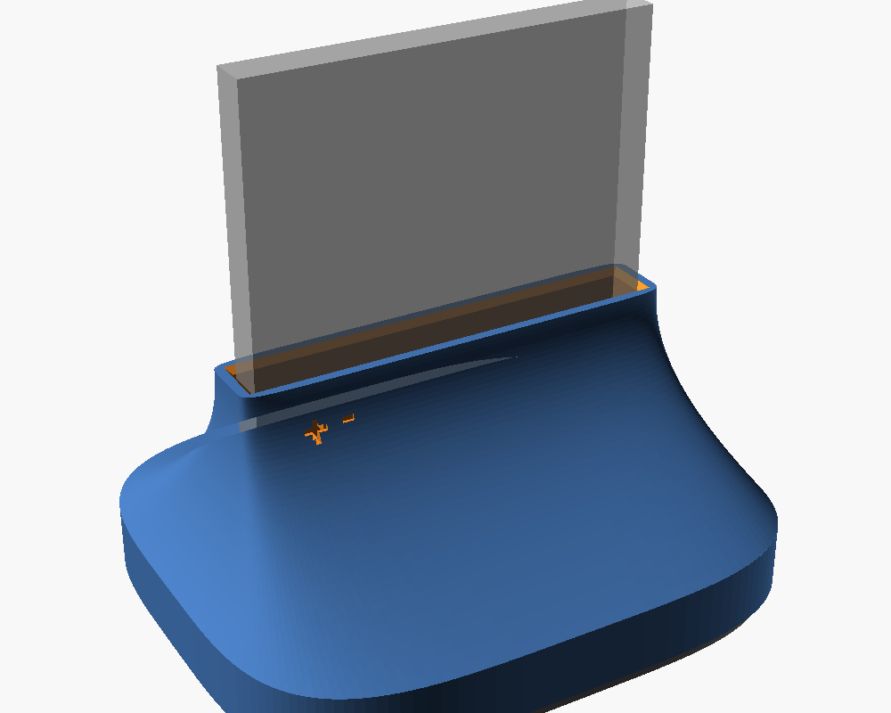
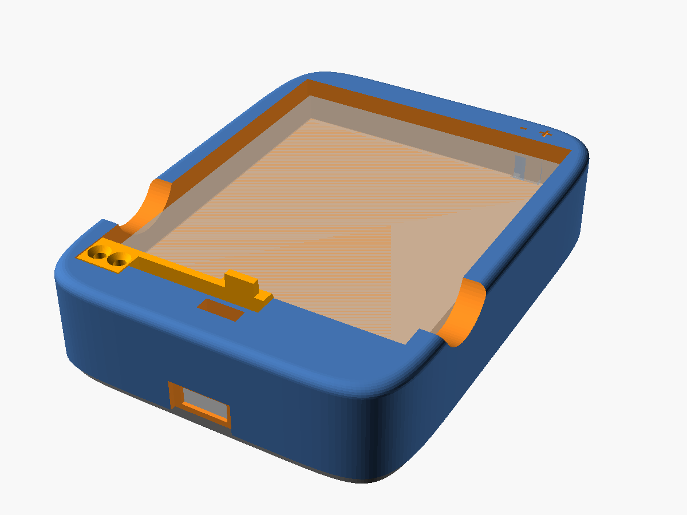

# XCover 7 battery desktop charger

3D-printable upright cradle prototype for the Samsung Galaxy XCover 7 battery (EB-BG556ABY). The battery stands on its contact end; a spring connector in the slot floor touches the battery pads. A TP4056 USB-C module sits in the foot.

Shape: a squircle foot (90 x 76 mm) with a short vertical skirt, sweeping up in a concave flare into a slim neck that holds the battery 30 mm deep (neck top 40 mm above the desk). The bottom plate is inset 1.5 mm from the foot edge, so a shadow line runs around the bottom and hides the plate seam.



## Files

| File | What |
|------|------|
| `XC7 battery.SLDPRT` | Battery model (source of all battery dimensions) |
| `charger.scad` | Parametric OpenSCAD source, all parts |
| `stl/cradle.stl` | Main body: foot, flare, neck with the battery slot |
| `stl/bottom.stl` | Bottom plate with TP4056 rails and connector posts |
| `docs/connectors.csv` | Connector donor/part research: links, pitch, dimensions, real vs estimated |
| `images/preview.png` | Assembly render |
| `test_charger.py` | OpenSCAD geometry regression checks; run `python3 -m unittest -v test_charger.py` |
| `docs/REVIEW.md` | Debate ledger, evidence, decisions, and remaining risks |
| `car.scad`, `stl/car_*.stl`, `images/car_preview.png`, `test_car.py` | Car version (glove box), see [Car version](#car-version) |
| `docs/CAR_REVIEW.md` | Car review debate, verification, and unresolved hardware limits |

## Battery contacts (from the SLDPRT)

- Battery 63 x 73 x 6.25 mm. Contacts on one 63 x 6.25 mm end face.
- 6 pads, each 2.0 mm wide x 3.25 mm tall, 2.5 mm pitch, recessed 0.1 mm, centered in the thickness.
- Pad 1 is nearest the corner: center 7 mm from that edge. Pads span 6-20.5 mm from the corner edge.
- **Pad 1 = +, pad 3 = −.** Pad 2 and pads 4-6 stay unconnected.
- Polarity is not marked in the model file; it was supplied by the owner.

## Connector

Need a spring connector with 2.5 mm pitch (2.54 mm also passes), 3 or more pins, mounted with its tips pointing up. Connector pin 1 goes on pad 1 (+), pin 3 on pad 3 (−).

Recommended, in order (details and sources in `docs/connectors.csv`):

1. Samsung 2.5 mm side-contact battery connector from an older removable-battery phone (Rp15k on Tokopedia). Search: `konektor baterai samsung j2 prime 4 pin`, `konektor baterai samsung j5 2016`. Pitch is inferred from Samsung's part naming, not confirmed: measure 5.0 mm between pin 1 and pin 3 with calipers.
2. Hroparts BC-25-3P-170 (LCSC C707322): current defaults in `charger.scad`. The [manufacturer drawing](https://datasheet.lcsc.com/datasheet/pdf/8153bae77de8ce951813d5d88903037f.pdf?productCode=C707322) shows a 7.5 x 5.0 x 1.7 mm housing with tips 1.35 ± 0.2 mm above it. DIM A is housing height; DIM B is total free height. Mount its PCB face down. For the -200 variant, set `con_d=2.0`.
3. 2.54 mm pogo pin strip (vertical or right-angle).

Not recommended: Nokia BL-5C / Nokia 105 connector (pitch unverified, sources claim 2.54 / 3.0 / 3.1 mm; blades are made for slotted contacts).

## Adapt the desktop design to another battery

The default design fits the Samsung Galaxy XCover 7 battery. It can be adapted to another rectangular phone battery when its contacts are on the end that sits in the cradle and its connector pins line up with a row of battery pads. This is a parametric starting point, not a universal fit. Save a copy of `charger.scad` for the other phone so the XCover 7 defaults remain available:

```sh
cp charger.scad other_phone_charger.scad
```

Open `other_phone_charger.scad` in OpenSCAD and edit its values.

Measure the battery and connector in millimeters. Confirm pad polarity and the pack's allowed charge voltage and current from reliable battery documentation; do not infer polarity from pad position.

Edit the matching values near the top of the copied `.scad` file:

| Values | Measure or set |
|--------|----------------|
| `bat_l`, `bat_t`, `bat_h` | Battery length along the pad row, thickness, and standing height |
| `pad_w`, `pad_pitch`, `pad1_x`, `pad_cy` | Pad width, center-to-center pitch, first pad center from the battery's corner edge, and pad-row position across the thickness |
| `clr` | Slot clearance per side; increase only if the measured battery needs more room |
| `con_n`, `con_pitch`, `con_w`, `con_h`, `con_d` | Connector pin count, pitch, and housing dimensions in the installed orientation |
| `con_tip`, `con_tip_y`, `finger_w` | Free contact-tip height and position, and contact nose width; measure the actual spring connector |
| `tip_protrusion`, `win_y`, `win_margin`, `con_fit`, `shim_gap` | Spring protrusion, floor window, connector-pocket fit, and support-post gap |
| `pcb_w`, `pcb_l`, `pcb_t`, `usb_w`, `usb_hgt`, `usb_overhang`, `led_from_usb`, `led_win` | Your charger board and USB-C/LED locations |

Keep the measurement directions used by the source: battery length runs along X, thickness along Y, and standing height along Z. `pad1_x` is measured from the battery's corner edge at the slot's inner -X side. The current fit check assumes connector pins align with consecutive pads, so set `con_pitch` to `pad_pitch`; small pitch differences pass only when each contact still lands within the pad. The built-in polarity marks assume connector pin 1 is positive and pin 3 is negative. If the other battery has a different pad order, non-consecutive power pads, or contacts on another face, edit the pin mapping, fit checks, contact window, and polarity marks in the source; changing dimensions alone is not enough.

Optional body-shape values include `foot` (half-sizes), `foot_n` / `neck_n` (roundness), `neck_top`, `skirt_h`, `flare_p`, `floor_z`, and `shadow_gap`. Change these only when the new battery or board needs a different body. Existing assertions check pin alignment and several clearances, but do not prove physical fit or electrical safety.

## Preview, render, and export

Open the copied `.scad` file in OpenSCAD. Press **F5** to preview the assembly; the battery appears as a ghost. Press **F6** to render the solid geometry. Check the dimensions and contact alignment before printing.

From a terminal in the project directory, save an updated assembly preview and export the printable parts. Replace `other_phone` in output names with the phone or battery model:

```sh
openscad --preview --autocenter --viewall --imgsize=1600,1200 -D 'part="assembly"' -o images/other_phone_preview.png other_phone_charger.scad
openscad -D 'part="cradle"' -o stl/other_phone_cradle.stl other_phone_charger.scad
openscad -D 'part="bottom"' -o stl/other_phone_bottom.stl other_phone_charger.scad
```

The assembly PNG is a visual preview, not a fit check. OpenSCAD stops on a failed assertion, such as a connector pin missing its pad or a board bay leaving the body. The current assertions do not check every possible connector, pad layout, or real-world tolerance.

Measure connector dimensions in its installed orientation. A side-contact donor may need its PCB face toward the back; the default BC-25 has its PCB face down. Its nominal floor thickness is 0.85 mm. The drawing's ±0.2 mm tip tolerance gives 0.3–0.7 mm free protrusion in that nominal pocket; measure your part before export. The 4 mm floor window clears an approximate envelope of the drawn free leaf; verify that the whole leaf clears the floor throughout compression. Working stroke and force are not specified in this drawing.

Fit assertions also stop rendering if a pin misses its pad, the floor over the connector is thinner than 0.8 mm, the connector is longer than its pocket, or the board bay reaches under the slot.

## Printing

- Cradle: print open side down, as modeled. Every outer surface leans inward, so no support is needed. The only bridge is the ~22 mm board bay ceiling. The foot is modeled solid; normal infill (15-20%) keeps it light. Use at least 3 perimeters so the M2 screws bite.
- Bottom plate: print flat, rails up.
- PLA or PETG.

## Assembly

Before powered use, verify the actual battery polarity, chemistry, permitted charge voltage/current, and the exact module's schematic and current-setting resistor. Battery nominal voltage is not its charge limit. The [TP4056 manufacturer datasheet](https://www.toppwr.com/uploadfile/file/20230304/640301eae1260.pdf) specifies 4.2 V regulation and a resistor-programmed current; this repository does not establish compatibility with your pack or module.

The two-wire connection below does not connect the battery's temperature sensor. Grounding the TP4056 `TEMP` pin disables battery-temperature sensing; its internal thermal regulation measures chip temperature. Verify your module's temperature protection before charging. No thermistor pad is identified here: do not guess one from the unused pads. These are mechanical assembly instructions, not a validated charging circuit.

1. Solder wires to connector pins 1 (+) and 3 (−).
2. Insert the connector from below into the pocket under the slot floor: pins in a row left to right, contacts pointing up through the floor window. For the default BC-25-3P-170, the PCB face points down and the free contact apex is toward +Y (the back). Seat the housing against the pocket ceiling and fix it with hot glue or CA without obstructing the springs. Four posts on the bottom plate back the housing corners when the plate is closed; route wires between them, and fill the `shim_gap` with glue. Orient other connectors according to the dimensions you measured.
3. Route the wires through the channel in the foot underside to the board bay. Wire to the TP4056 `B+` / `B-`.
4. Place the TP4056 between the rails on the bottom plate, USB-C toward the back.
5. Close with 4 x M2 countersunk self-tapping screws (about 8 mm) into the solid foot.
6. Insert the battery contact end down, pad 1 on the left (at the "+" mark). Inserted the wrong way round, the pads land at the far end of the slot and touch nothing.

## Known limitations

- Gravity only: BC-25 spring force and working stroke are unverified. Contact reliability depends on the actual battery weight, spring preload, and number of loaded pins. Verify stable contact without power; a clip may be needed after the permitted stroke is established.
- No clip arm. If one is needed, the cradle has to be redesigned and reprinted.
- Default connector and TP4056 dimensions are datasheet/typical values; measure your parts.
- Not test-printed or test-fitted.

## Car version

`car.scad` is a separate mechanical prototype for a glove box: the battery lies flat in a pocket, like in the phone. Vehicle charging and retention are not qualified. The desktop files are unchanged.

Do not use this prototype for unattended charging or leave the battery in a hot parked car. [Samsung's battery care guidance](https://www.samsung.com/us/support/galaxy-battery/care-and-maintenance/) warns against prolonged hot-car exposure; it does not specify this loose pack's charging limits. Establish the actual pack's charge/storage limits and verify a battery-temperature cutoff on the actual charger before vehicle charging. PETG/ASA and the TP4056's chip-temperature regulation do not provide battery-temperature protection. The [TP4056 datasheet](https://www.toppwr.com/uploadfile/file/20230304/640301eae1260.pdf) describes the separate `TEMP` input; grounding it disables battery-temperature sensing.



How it holds the battery:

- The connector sits in the contact-end wall with its springs pointing sideways at the pads. The springs push the battery against the far wall, so contact force comes from the pocket length, not gravity.
- A lip over the contact end and a clip arm over the far end stop the battery lifting.
- Insert: hold the clip clear, put the contact end under the lip, press it gently toward the contact wall, then lower the far end. Release the clip after seating. The deeper far-wall chamfer clears the tilted battery while retaining a 2.5 mm vertical stop.
- Remove: hold the clip clear, press the battery gently toward the contact wall, then lift the far end using the side scoops. The modeled path tilts through 0–10 degrees; verify this motion without power and never force the spring contacts.
- Flipped over, the pads land at the far side of the end wall and touch nothing. The "+" mark on the top shows where pad 1 goes.

The Samsung side-contact donor (rank 1 in `docs/connectors.csv`) has a candidate contact direction; measure the actual part. The default BC-25 housing and approximate free-leaf envelope clear the CAD: its PCB face stands against the back of the shaft, with the drawing's -Y face down. Working stroke, contact force, and soldered wire clearance still require a physical check.

Default footprint: 73.6 x 97.31 mm. Body and plate: 22.05 mm tall; 25.04 mm including the thumb nub.

### Before printing

Same connector and TP4056 parameters as the desktop version, plus:

| Parameter | Meaning |
|-----------|---------|
| `preload` | Spring compression with the battery seated (default 0.3 mm). Sets the pocket length. Must stay below `tip_protrusion` |
| `tip_protrusion` | Free tip past the end wall (0.5 mm). The battery can be pushed a further `tip_protrusion - preload` (0.2 mm) into the springs; together with the far-wall chamfer, that lets the far end drop in |
| `clr_z` | Battery lift play under the lip and the clip |
| `apex_tol` | How far the contact apex may land from the pad center across the thickness; measure the spring's sweep |
| `con_tip_y` | Apex distance from the housing's bottom face (installed) |
| `tail` | Space behind the housing for solder tails and wires |

The battery length tolerance changes the preload directly: measure your battery's length and the connector's free tip before export, and print a test pocket if you can. Clip knobs: `hook`, `arm_t`, `anchor`, `arm_strain_max`. The clip is modeled as a cantilever beam with a rigid tab, pushed at the thumb nub. The tab rotates as the beam bends, so its free end moves further than its anchor-side edge (default 2.96 mm vs 1.5 mm). The recess behind the beam is sized from that free-end travel, and rendering stops if the beam's root strain exceeds `arm_strain_max` (default 1.12% against 1.2%). This is a beam-theory screen against a chosen limit; it does not predict cracking, fatigue, or hot-car behavior. The sampled wall checks likewise do not certify every local wall thickness.

### Export

```
openscad --hardwarnings --export-format=binstl -D 'part="cradle"' -o stl/car_cradle.stl car.scad
openscad --hardwarnings --export-format=binstl -D 'part="bottom"' -o stl/car_bottom.stl car.scad
openscad --hardwarnings --export-format=binstl -D 'part="arm"' -o stl/car_arm.stl car.scad
```

These commands produce compact binary STL files. The body uses one continuous loft to avoid sliver triangles at the rounded seam. Export checks cover closed edges and zero-area triangles; a successful OpenSCAD render alone is insufficient.

Tests: `python3 -m unittest -v test_car.py`.

### Printing

- PETG or ASA are candidate print materials; qualify the actual print for the measured temperature and load. Material choice alone does not establish vehicle suitability.
- Cradle: put the bottom-plate mating face on the bed (Z=0), with the battery pocket facing up. Bridges include the ~21 mm board bay ceiling and small shaft/channel ceilings. The contact-end lip is a 1.2 mm overhang. Check supports and bridging in your slicer.
- Clip arm: flat on its underside, as modeled. This way the beam bends along its layers.
- Bottom plate: flat, rails and posts up.

### Assembly

The desktop electrical notes apply.

1. Solder wires to connector pins 1 (+) and 3 (−).
2. Slide the connector up into the shaft from below, contacts toward the pocket. The leaves pass up through the open window slot. Seat the housing against the wall, with the two ribs behind it. Fix it with epoxy (hot glue softens in a hot car), keeping glue off the springs. Wires run down between the ribs.
3. Route the wires through the channel in the underside to the board bay. Wire to the TP4056 `B+` / `B-`.
4. Place the TP4056 between the rails, USB-C toward the far end.
5. Close with 4 x M2 countersunk self-tapping screws (about 8 mm). The plate posts sit under the housing ends.
6. Screw the clip arm on with 2 x M2 countersunk screws (8-10 mm).
7. Stick the plate to the glove box with VHB tape. The tape covers the plate screws; peel it to open the charger.

Power: use a regulated 5 V USB supply from a vehicle USB adapter, never the vehicle's raw 12/24 V. Verify the actual adapter/module combination supplies 5 V. Check whether the vehicle socket really switches off with the ignition; this design has no independent ignition shutoff.

### Known limitations

- Spring stroke, force, and sweep of the BC-25 are unverified, and so is the preload. Test contact with the battery seated, without power, before charging.
- Clip release is unverified. The recess is sized from a beam-theory estimate, and the CAD test shifts the free beam by that estimate. The printed clip can still behave differently. Print and test release without power before assembly for use. Do not force a binding clip. The strain estimate does not establish printed-material strength or fatigue life; the separate arm can be reprinted after calibration.
- Not test-printed or test-fitted.
