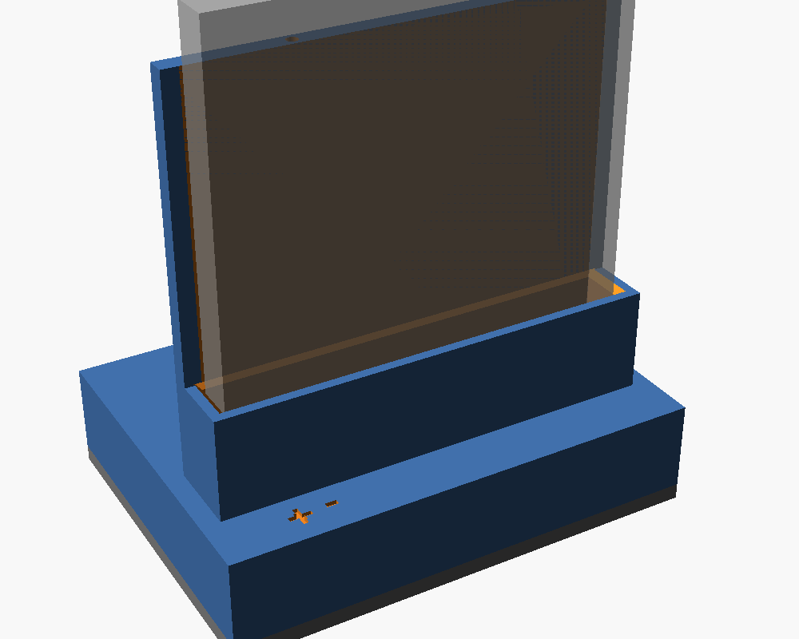

# XCover 7 battery desktop charger

3D-printable upright cradle prototype for the Samsung Galaxy XCover 7 battery (EB-BG556ABY). The battery stands on its contact end; a spring connector in the slot floor touches the battery pads. A TP4056 USB-C module sits in the base.



## Files

| File | What |
|------|------|
| `XC7 battery.SLDPRT` | Battery model (source of all battery dimensions) |
| `charger.scad` | Parametric OpenSCAD source, all parts |
| `cradle.stl` | Main body: base, slot, back wall |
| `bottom.stl` | Bottom plate with TP4056 rails |
| `connectors.csv` | Connector donor/part research: links, pitch, dimensions, real vs estimated |
| `preview.png` | Assembly render |
| `test_charger.py` | OpenSCAD geometry regression checks; run `python3 -m unittest -v test_charger.py` |
| `REVIEW.md` | Debate ledger, evidence, decisions, and remaining risks |

## Battery contacts (from the SLDPRT)

- Battery 63 x 73 x 6.25 mm. Contacts on one 63 x 6.25 mm end face.
- 6 pads, each 2.0 mm wide x 3.25 mm tall, 2.5 mm pitch, recessed 0.1 mm, centered in the thickness.
- Pad 1 is nearest the corner: center 7 mm from that edge. Pads span 6-20.5 mm from the corner edge.
- **Pad 1 = +, pad 3 = −.** Pad 2 and pads 4-6 stay unconnected.
- Polarity is not marked in the model file; it was supplied by the owner.

## Connector

Need a spring connector with 2.5 mm pitch (2.54 mm also passes), 3 or more pins, mounted with its tips pointing up. Connector pin 1 goes on pad 1 (+), pin 3 on pad 3 (−).

Recommended, in order (details and sources in `connectors.csv`):

1. Samsung 2.5 mm side-contact battery connector from an older removable-battery phone (Rp15k on Tokopedia). Search: `konektor baterai samsung j2 prime 4 pin`, `konektor baterai samsung j5 2016`. Pitch is inferred from Samsung's part naming, not confirmed: measure 5.0 mm between pin 1 and pin 3 with calipers.
2. Hroparts BC-25-3P-170 (LCSC C707322): current defaults in `charger.scad`. The [manufacturer drawing](https://datasheet.lcsc.com/datasheet/pdf/8153bae77de8ce951813d5d88903037f.pdf?productCode=C707322) shows a 7.5 x 5.0 x 1.7 mm housing with tips 1.35 ± 0.2 mm above it. DIM A is housing height; DIM B is total free height. Mount its PCB face down. For the -200 variant, set `con_d=2.0`.
3. 2.54 mm pogo pin strip (vertical or right-angle).

Not recommended: Nokia BL-5C / Nokia 105 connector (pitch unverified, sources claim 2.54 / 3.0 / 3.1 mm; blades are made for slotted contacts).

## Before printing: measure and edit

Open `charger.scad` and set these at the top:

| Parameter | Meaning |
|-----------|---------|
| `con_n`, `con_pitch` | Pin count and pitch |
| `con_w` | Housing length along the pin row |
| `con_h` | Installed housing depth along Y (front to back) |
| `con_d` | Installed housing height along Z, below the contact face; include any downward tail clearance |
| `con_tip` | Free tip height above the housing contact face |
| `con_tip_y` | Free contact apex from the housing's -Y face; BC-25 nominal 3.75 mm, verify its sweep under compression |
| `finger_w` | Contact nose width |
| `pcb_w`, `pcb_l`, `usb_overhang`, `led_from_usb` | Your TP4056 module |

Calibration knobs: `tip_protrusion` (tip height above the slot floor, default 0.5 mm), `clr` (slot clearance per side, 0.3 mm), `win_y` (contact window width), `shim_gap` (gap between the bottom-plate posts and the connector underside, 0.2 mm).

Measure connector dimensions in its installed orientation. A side-contact donor may need its PCB face toward the back; the default BC-25 has its PCB face down. Its nominal floor thickness is 0.85 mm. The drawing's ±0.2 mm tip tolerance gives 0.3–0.7 mm free protrusion in that nominal pocket; measure your part before export. The 4 mm floor window clears an approximate envelope of the drawn free leaf; verify that the whole leaf clears the floor throughout compression. Working stroke and force are not specified in this drawing.

The file has fit checks: rendering stops with an error if a pin would miss its pad (e.g. 3.0 mm pitch fails), the floor over the connector gets thinner than 0.8 mm, or the connector is longer than its pocket.

## Export

```
openscad -D 'part="cradle"' -o cradle.stl charger.scad
openscad -D 'part="bottom"' -o bottom.stl charger.scad
```

`part="assembly"` (default) is preview only and shows the battery as a ghost.

## Printing

- Cradle: print open side down, as modeled. The ceiling over the board bay is a ~32 mm bridge; enable support on build plate only if your printer sags.
- Bottom plate: print flat, rails up.
- PLA or PETG.

## Assembly

Before powered use, verify the actual battery polarity, chemistry, permitted charge voltage/current, and the exact module's schematic and current-setting resistor. Battery nominal voltage is not its charge limit. The [TP4056 manufacturer datasheet](https://www.toppwr.com/uploadfile/file/20230304/640301eae1260.pdf) specifies 4.2 V regulation and a resistor-programmed current; this repository does not establish compatibility with your pack or module.

The two-wire connection below does not connect the battery's temperature sensor. Grounding the TP4056 `TEMP` pin disables battery-temperature sensing; its internal thermal regulation measures chip temperature. Verify your module's temperature protection before charging. No thermistor pad is identified here: do not guess one from the unused pads. These are mechanical assembly instructions, not a validated charging circuit.

1. Solder wires to connector pins 1 (+) and 3 (−).
2. Insert the connector from below into the pocket under the slot floor: pins in a row left to right, contacts pointing up through the floor window. For the default BC-25-3P-170, the PCB face points down and the free contact apex is toward +Y (the back). Seat the housing against the pocket ceiling and fix it with hot glue or CA without obstructing the springs. Four posts on the bottom plate back the housing corners when the plate is closed; route wires between them, and fill the `shim_gap` with glue. Orient other connectors according to the dimensions you measured.
3. Route the wires through the channel in the slot block to the board bay. Wire to the TP4056 `B+` / `B-`.
4. Place the TP4056 between the rails on the bottom plate, USB-C toward the back.
5. Close with 4 x M2 self-tapping screws.
6. Insert the battery contact end down, pad 1 on the left (at the "+" mark). Inserted the wrong way round, the pads land at the far end of the slot and touch nothing.

## Known limitations

- Gravity only: BC-25 spring force and working stroke are unverified. Contact reliability depends on the actual battery weight, spring preload, and number of loaded pins. Verify stable contact without power; a clip may be needed after the permitted stroke is established.
- No clip arm. If one is needed, the cradle has to be redesigned and reprinted.
- Default connector and TP4056 dimensions are datasheet/typical values; measure your parts.
- Not test-printed or test-fitted.
